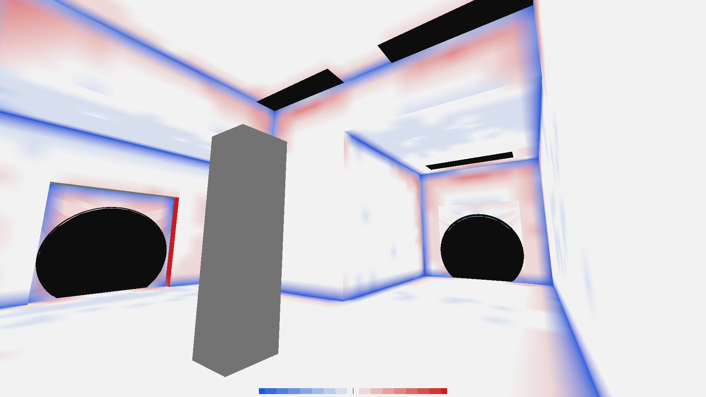
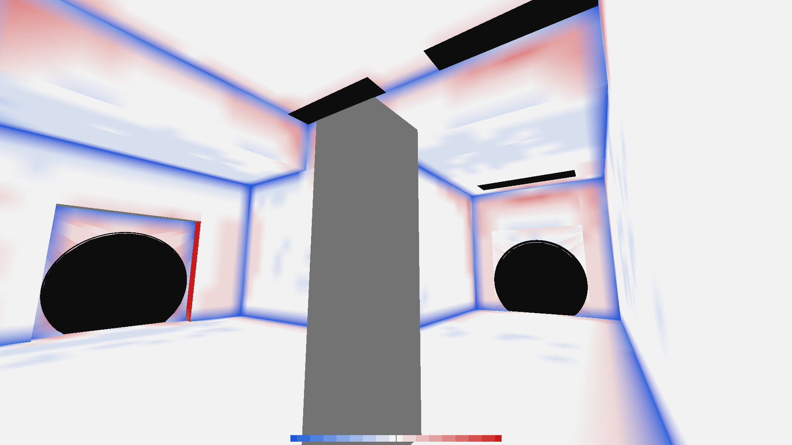
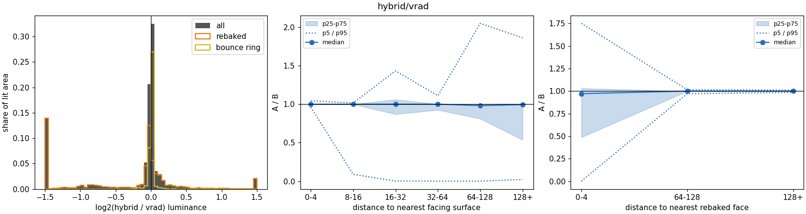
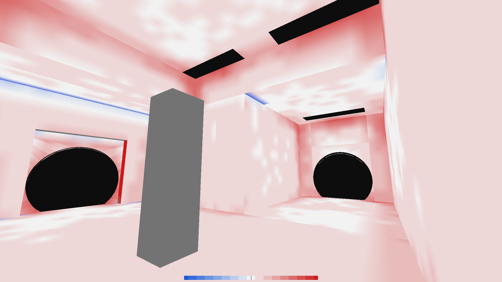
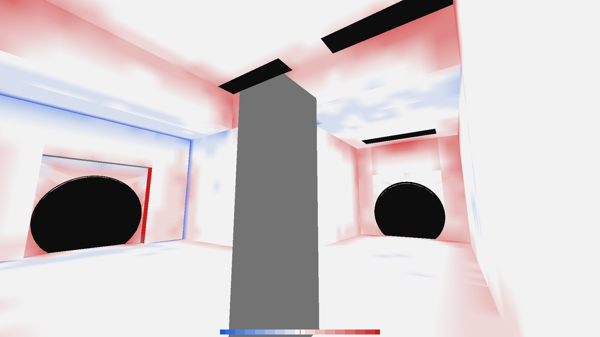

# 0.7.7 Hybrid P0: per-luxel comparison against VRAD

Question: the Hybrid view matches VRAD on average once its bounces settle, but corners look darker. Is this
the hybrid seeding or the baker?

## Tooling

- `apex_render_pose --diff A,B` (A, B in `baked`, `hybrid`, `vrad`) resamples both sources onto the
  `--vmf`'s baker charts and compares luminance per luxel. It prints area-weighted quantiles of A/B, writes
  `luxels-A-B.csv` (position, normal, area, hybrid class, distance to the face's own edge, to the nearest
  facing surface, and to the nearest rebaked face, both RGB values, validity) and per pose a matte
  `NAME-diff-A-B.png`: white equal, red A brighter, blue A darker, banded every 1/8 of `--diff-range` in
  log2 (default: full colour at 2x / 0.5x), grey where B is below 0.002 or VRAD gave no data.
- `--mode hybrid --baseline-vmf BEFORE.vmf` runs the editor's Hybrid path headless: VRAD on the baseline,
  seed, bake the edited map until idle. With hybrid involved it also writes `NAME-hybrid-class.png`
  (rebaked orange, bounce ring yellow, frozen grey).
- `tools/lightmap_diff_report.py luxels-A-B.csv` prints the tables below and plots the histogram and
  binned ratios.

Map: `test1.vmf` with a 32x32x128 pillar added (`derived/test1_pillar.vmf`), and the same pillar moved 64
units (`derived/test1_pillar_moved.vmf`). Tuned defaults (8 bounces, 4 passes), VRAD `-noextra`.

## Results

**Baked vs VRAD** (pillar map, no hybrid): energy ratio 0.95, median 0.99, but only 37% of lit area within 10%.

| distance to own face edge | luxels | p25 | median | p75 | within 10% |
|---|---:|---:|---:|---:|---:|
| 0-4 | 3305 | 0.498 | **0.714** | 1.156 | 16.6% |
| 4-8 | 444 | 0.648 | 0.939 | 1.186 | 19.8% |
| 8-16 | 1137 | 1.020 | 1.114 | 1.792 | 32.0% |
| 32-64 | 1401 | 0.948 | 0.987 | 1.035 | 64.4% |
| 64-128 | 909 | 0.974 | 0.984 | 1.000 | 79.8% |



Every concave crease has a blue band one luxel wide (about 0.5-0.7x), often with a faint red band
just inside it. This is the darkening seen in the Hybrid view, and it is already present with no hybrid
involved.

**Hybrid vs VRAD** (baseline: pillar map; edit: pillar moved 64 units): 220 faces rebaked, 157 frozen.
Adding a brush instead changes the face set and falls back to a full rebake ("face set changed"), so it
does not exercise the seeding.

| subset | luxels | p5 | median | p95 | within 10% |
|---|---:|---:|---:|---:|---:|
| bounce ring (frozen at VRAD) | 3440 | 0.979 | 1.000 | 1.013 | 98.6% |
| rebaked | 6302 | 0.001 | 0.972 | 1.752 | 45.4% |



The frozen faces match VRAD to about 1%; all of the error is in the rebaked faces, which show the same
crease pattern as pure Baked. The hybrid seeding does not cause the corner darkening. It does make the
darkening more visible, because rebaked faces sit next to frozen VRAD faces.



## Causes

1. **Corner darkening (baker sampling).** `Baker::sample` and `Baker::sampleBounce` take four samples at
   the luxel's corners (`coordinate ± 0.5`), 1 unit off the plane, and never clip them to the face polygon.
   For an edge luxel along a concave crease, half of those points sit on the adjacent wall or behind it:
   direct visibility tests start inside or against that wall, and bounce rays start next to it. VRAD
   moves its sample points inside the face winding and supersamples only the part of the luxel that is on
   the face. Fix candidate: clamp each sample point into the face polygon (inset about 1 unit) before
   offsetting along the normal, then re-run this diff. Expected result: the edge 0-4 bin median should
   rise from 0.71 to about 1.
2. **Dim region north of the room (separate issue).** About 14% of the valid area, mostly faces of solids
   258-275 around y -320 to -640, comes out near black in Baked (median luminance 1e-4) but 0.003-0.04
   in VRAD: 50-100x darker. This appears in both the Baked and the Hybrid diff, so it is also a
   baker-side difference, probably light reaching that area only through a path the baker misses. It is
   out of view in these poses and not yet diagnosed.

## Fix: clamp sample points into the face

`lighting::clampToFace` (baker.cpp) moves any luxel-corner sample point that lies outside the face, or less
than 1 unit inside it, to the nearest boundary point and then 1 unit towards the centre; `Baker::sample`
and `Baker::sampleBounce` use it. The sealed-room energy test now weights luxels by their coverage of the
face: the unweighted mean counted half-covered edge luxels as whole ones, and those had been reading near
zero bounce from behind the walls.

Same maps and poses, after the fix:

| | energy | median | within 10% | edge 0-4 median | edge 32-64 median |
|---|---:|---:|---:|---:|---:|
| Baked/VRAD before | 0.95 | 0.990 | 37.0% | 0.714 | 0.987 |
| Baked/VRAD clamped | 1.13 | 1.088 | 35.2% | 1.131 | 1.061 |
| Hybrid/VRAD before | 0.94 | 0.999 | 65.0% | 0.981 | 0.986 |
| Hybrid/VRAD clamped | 1.10 | 1.004 | 60.3% | 1.000 | (rebaked median 1.060) |
| Baked/VRAD direct only (`--bake-bounces 0`, `-bounce 0`), clamped | 1.26 | 1.103 | 43.5% | 1.442 | 1.036 |



The crease bands are gone. Two things remain:

- **A broad warm offset.** Rebaked faces now run about 6% above VRAD in face interiors and 10-25% in concave
  corners. The earlier tuning (bounce count, passes) was set against the old sampling, which lost bounce
  energy at every crease, so the hot result needs a retune against VRAD.
- **VRAD darkens its own creases in direct light.** With bounces off, VRAD's edge luxels are well below
  ours (our edge median is 1.44x VRAD's; interiors are 1.04x). With `-noextra`, VRAD samples one point per
  luxel at its centre, which for an edge luxel is on the edge itself, against the neighbouring wall. Baked
  averages four points clamped 1 to 8 units inside. Exact parity at creases would mean copying that
  behaviour (centre sampling with a small inset) rather than physically spreading the samples over the
  luxel.

## Retune: bounce reflectivity 0.97

Metrics below leave out the dim-region outliers (|log2 ratio| >= 2); "interior" is 32+ units from the
face's own edge.

- **Inset distance does not matter.** Moving the clamp's inset from 0.125 to 4 units changes every bin by
  under 1%. The remaining edge excess comes from the edge luxel's two inner sample points, not from where
  the outer two are clamped.
- **Direct light matches in face interiors.** With bounces off on both sides (`--bake-bounces 0`, VRAD
  `-bounce 0`), the interior median is 1.002; edges are 1.25.
- **Bounce is too strong.** The interiors are mostly bounce-lit (direct alone is 0.34 of VRAD's total
  there). Baked with 6/8/12 bounces gives interior medians of 1.012/1.060/1.097 and is still rising.
  Fitting a geometric series puts our effective per-bounce reflectance at about 0.69 against VRAD's 0.66,
  so about 5% too high. VRAD `-final` gives the same results as `-noextra` here. The reflectivity inputs are
  the same as VBSP's (`$reflectivity`, else the VTF's), so the difference is in the transport: VRAD's coarse
  patch radiosity passes on less light per bounce. Bounce count is the wrong knob, because truncating the
  series would only fit this one room.
- **Display scale cannot fix it.** It multiplies frozen VRAD faces as well, so it cannot close a seam
  between frozen and rebaked faces.

`BakerOptions::bounceReflectivity` scales every albedo in bounce transport only. Its default stays 1 (the
energy tests rely on that), but the editor's session options and render_pose use
`lighting::kVradBounceReflectivity`, fitted on test1:

| bounce reflectivity | median | within 10% | edge 0-4 median | interior median | interior within 10% |
|---:|---:|---:|---:|---:|---:|
| 1.00 | 1.098 | 45.0% | 1.175 | 1.060 | 72.3% |
| **0.97** | 1.057 | 52.7% | 1.123 | **0.997** | **82.1%** |
| 0.95 | 1.038 | 53.0% | 1.095 | 0.961 | 80.4% |
| 0.93 | 1.020 | 45.8% | 1.074 | 0.924 | 54.8% |
| 0.90 | 0.987 | 31.9% | 1.046 | 0.872 | 19.7% |

0.97 matches face interiors, which cover most of each face, and ties 0.95 on overall within-10%. Lower
values only pull the overall median down by darkening interiors to offset the edges.

Hybrid vs VRAD, moved pillar:

| baker | median | within 10% | edge 0-4 median | rebaked median | ring within 10% |
|---|---:|---:|---:|---:|---:|
| original | 1.000 | 76.2% | 1.000 | 0.972 | 98.6% |
| clamp only | 1.028 | 70.5% | 1.005 | 1.060 | 98.7% |
| clamp + reflectivity 0.97 | 1.000 | 77.2% | 1.000 | 0.999 | 99.2% |



Remaining: concave corners run about 10-20% warm. This is the edge-luxel footprint (four points spread
over the luxel) against VRAD's single centre sample on the edge. The fit uses one map; confirm it on a
second map with different albedos before treating 0.97 as general.

## Reproduce

```
apex_render_pose --vmf derived/test1_pillar_moved.vmf --baseline-vmf derived/test1_pillar.vmf \
  --game "$APEX_P2CE_DIR" --mode hybrid --diff hybrid,vrad \
  --pose p1 -1135.97 -1135.97 64.03 -9.13 34.18 0 --out OUT
tools/lightmap_diff_report.py OUT/luxels-hybrid-vrad.csv
```

Known gap: the added pillar has no VRAD data (grey in the mattes; `unowned=7`), so it is excluded from
the statistics.
